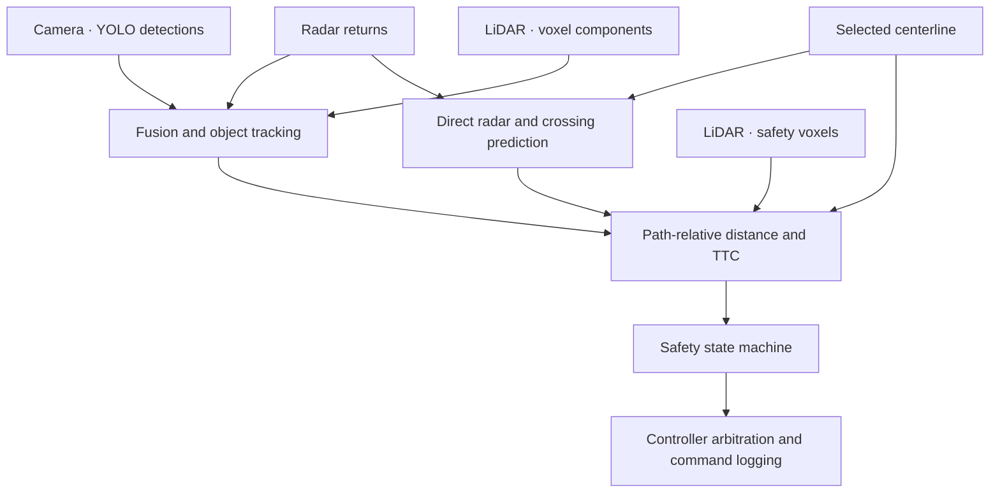
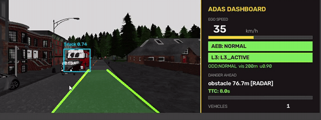

# CARLA ADAS · Pedestrian AEB validation

[](https://github.com/nhatduongchess-cloud/carla-adas-active-safety-project/actions/workflows/selftest.yml)

**Does the vehicle recognize a crossing conflict early enough to brake?** In Town02, the revised system met the **1.0 s first-response deadline in 20/20 crossings**. In the matched storm case, the first brake command moved from **1.225 s to 0.700 s**. Four sidewalk controls produced **zero AEB commands**. [Per-case measurements](docs/benchmarks/pedestrian_deadline_20261123.json)

[Results](#results) · [Replay the regression](#replay-the-storm-case-offline) · [Lane selection](#lane-detection-and-the-aeb-corridor) · [Engineering documentation](docs/README.md)

## Pedestrian-crossing response

The requirement starts the clock when the scenario commands the walker to cross. The first decision outside `NORMAL` stops the clock, including a `FOLLOW` decision. A second timestamp records when the controller sends a positive AEB command. [Acceptance criterion](modules/scenario_acceptance.py) · [Command logging](modules/pedestrian_response.py)

### Why the brake command moved from frame 49 to frame 28

In the Town02 storm case with seed 1, the scenario commanded the walker to cross at frame 0. Each simulation step lasted 0.025 s. At the 1.0 s deadline, the original system had no confirmed person track. Radar had measured the approaching target outside the current corridor. Once a return entered the corridor, the controller sent AEB on that same frame. [Walker trigger](modules/scenario_library.py) · [Decision and command records](docs/benchmarks/pedestrian_deadline_20261123.json)

| Storm, seed 1 | Frames 0–28 | First safety response | TTC source and estimate at first response | First positive AEB command sent |
|---|---|---|---|---|
| Before | Direct radar check remained in `NORMAL` | Frame 49 · 1.225 s | In-corridor radar · 0.99 s | Frame 49 · 1.225 s |
| After | Radar motion forecast detected a conflict at frame 28 | Frame 28 · 0.700 s | Radar crossing predictor · 1.58 s | Frame 28 · 0.700 s |

Radar positions, ego speed and the map centerline matched between the runs through frame 28. The predictor fits target motion across ego-motion-compensated radar scans and checks for lane overlap at the vehicle’s estimated arrival time. The offline test feeds that shared input prefix into both radar paths. The recorded episode summaries supply the later frame-49 result and the controller’s command timestamps. [Radar predictor](modules/radar_crossing.py) · [Recorded input prefix](tests/fixtures/safety/town02_storm_radar_prefix.json.gz) · [Episode summaries](docs/benchmarks/pedestrian_deadline_20261123.json)

**Trade-off.** In clear weather with seed 9, the first AEB command moved later, from 0.275 to 0.700 s. After the change, the first safety decision occurred at 0.600 s. A `FOLLOW` decision can satisfy the response criterion before any brake command is sent. The data support a deadline claim across this matrix. The cause of the seed 9 timing difference remains unresolved. [Matched runs](docs/benchmarks/pedestrian_deadline_20261123.json) · [Timing implementation](run_scenarios.py)

<a id="results"></a>

## Validation results and limits

Town02, CPU inference, 20 simulated seconds per case. Response and AEB times below are measured from the walker command in simulation time. TTC estimates time remaining to a predicted conflict. Clearance is the minimum surface-to-surface gap over an episode. The command timestamp measures a controller output; physical deceleration onset was not measured. [Per-case benchmark, 2026-11-23](docs/benchmarks/pedestrian_deadline_20261123.json)

| Scenario | Weather / seeds | Passed | First safety response (s) | First AEB sent (s) | Collisions | Min. clearance (m) |
|---|---|---:|---:|---:|---:|---:|
| Crossing | Clear / 1–10 | 10/10 | 0.600–0.700 | 0.675–0.725 | 0 | 3.40 |
| Crossing | Storm / 1–10 | 10/10 | 0.700 | 0.700 | 0 | 3.02 |
| Standing or walking parallel to the road | Clear and storm / 1 | 4/4 | None | None | 0 | 1.87 |

The controls checked that the ego vehicle actually passed each walker without braking or evading on approach. Zero AEB commands in four exposures bounds the observation to those encounters. Occluded crossings, other approach speeds and cluttered sidewalks require separate trials. [Control definitions](modules/scenario_library.py) · [Control outcomes](docs/benchmarks/pedestrian_deadline_20261123.json)

**Historical comparison.** On November 9 the Town02 core suite passed 6/6 cases in clear weather with seed 42. Its single pedestrian crossing reached the first safety response at 0.600 s. The earlier September crossing reports recorded five late responses across 20 trials; those summary records alone cannot identify the triggering TTC source. [Seed 42 benchmark](docs/benchmarks/core_town02_seed42_20261109.json) · [September clear](docs/benchmarks/v2_doc_clear_10seed.json) · [September storm](docs/benchmarks/v2_doc_storm_10seed.json)

<a id="lane-detection-and-the-aeb-corridor"></a>

## How lane selection changes braking

At 8 m/s, place a LiDAR obstacle 4.0 m ahead and 2.6 m to the right. In the offline test the selected curved centerline passes through the obstacle and AEB requests `BRAKE`. Hold the obstacle and speed fixed, then expire the lane estimate or mark the location as a junction. The arbiter selects the straight map corridor and the safety decision is `DRIVE`. This isolates corridor selection from image-model accuracy. [Executable example](tests/test_pedestrian_response.py) · [Lane arbiter](modules/lane_source.py)

The 20 crossing cases used the map corridor. In a separate storm run with seed 1, the UFLDv2 worker completed inference on CPU. Its outputs were already stale when polled, and the arbiter selected the map on **800/800 control ticks**. The tracked summary records lane use, AEB at 0.700 s and the checksum of the local worker report. A matched live run with a learned centerline selected on a bend would be needed to measure its effect on braking. [Focused lane run](docs/benchmarks/pedestrian_deadline_20261123.json)

### From sensors to the brake command



The named crossing benchmark uses the map route as its centerline. The focused lane run adds UFLDv2 inference and lane selection. Geometry is evaluated each control tick while camera inference runs asynchronously. [Benchmark pipeline](run_scenarios.py) · [LiDAR processing](modules/lidar_processor.py) · [Safety state machine](modules/safety_fsm.py)

<a id="getting-started"></a>

## Reproduce the result

### Replay the storm case offline

From the repository root in a Python 3.12 environment, install the offline dependencies and run the recorded regression. It checks that direct radar stays in `NORMAL` throughout the prefix and that the predictive path requests braking at frame 28. The second test exercises the curved-lane example.

```sh
python -m pip install -r requirements-selftest.txt
python -m unittest tests.test_radar_crossing.RadarCrossingTests.test_recorded_storm_radar_precedes_direct_corridor
python -m unittest tests.test_pedestrian_response.PedestrianResponseTests.test_selected_corridor_changes_obstacle_membership
```

### Run the live CARLA benchmark

Use a Python environment with the CARLA client matching your server build. Install the runtime dependencies and prepare the YOLOv8n weights in the repository root. Start the matching CARLA server on localhost port 2000 before running the matrix. The replay output directory must be new for each capture. [Runtime requirements](requirements.txt) · [Configuration](config.py) · [Replay runbook](docs/PYTHON_SAFETY_REPLAY.md)

```sh
python -m pip install -r requirements.txt
python -c "from ultralytics import YOLO; YOLO('yolov8n.pt')"
python run_scenarios.py --town Town02 --scenarios DynamicObjectCrossing --seeds 1,2,3,4,5,6,7,8,9,10 --weathers clear,storm --seconds 20 --inference-device cpu --report logs/deadline.json --safety-replay-out logs/deadline-traces
python run_scenarios.py --town Town02 --scenarios pedestrian-controls --seed 1 --weathers clear,storm --seconds 20 --inference-device cpu --report logs/sidewalk.json
```

### Offline CI

CI runs Ruff, mypy, the geometry and safety self-checks (`python selftest.py`), and an explicit group of `unittest` modules. The workflow contains the full unit-test invocation and its dependency installation steps. Self-checks and unit tests are counted separately. [CI commands](.github/workflows/selftest.yml) · [Self-checks](selftest.py)

<a id="scope--status"></a>

### Project scope and demo

The validation claims above cover the CARLA scenarios listed in the table. The broader simulator also includes longitudinal and lateral control, weather monitoring and a live dashboard. The clip below shows the dashboard in Town10HD. [Architecture](docs/ARCHITECTURE.md) · [Requirement map](docs/REQUIREMENT_MAP.md) · [Demo runbook](docs/DEMO_RUNBOOK.md) · [Benchmark archive](docs/benchmarks/README.md)



**Author** · Duong Quang Nhat. The project builds on CARLA, Ultralytics YOLO, UFLDv2 and the original perception pipeline. [CARLA](https://github.com/carla-simulator/carla) · [Ultralytics](https://github.com/ultralytics/ultralytics) · [UFLDv2](https://github.com/cfzd/Ultra-Fast-Lane-Detection-v2) · [Original perception project](https://github.com/mahinarshad28-glitch/Self-Driving-Perception) · [MIT license](LICENSE)
